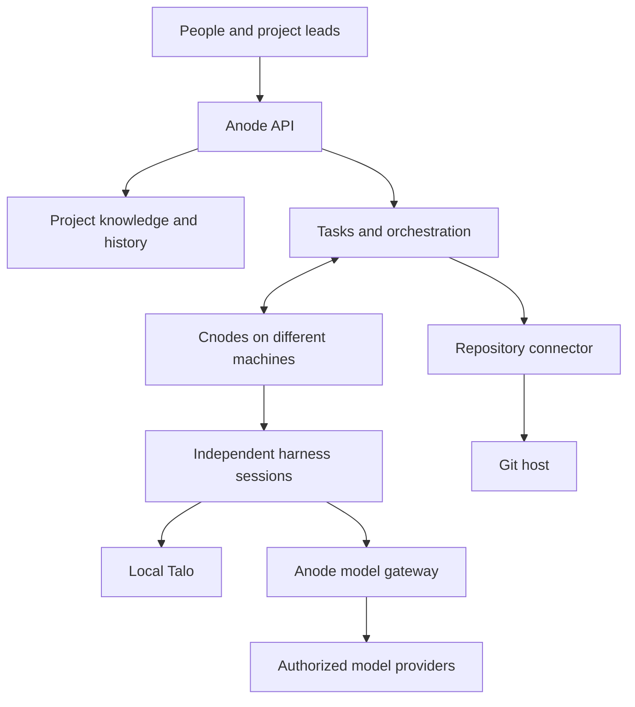

# Anode

**Independent agents. Shared direction.**

Anode is the server for coordinating coding agents across machines and people. It preserves project knowledge and development history, assigns work to connected Cnodes, and records what was decided, implemented, reviewed and accepted.

**Status: documentation starter, design version 0.1, 15 November 2026.** This repository contains specifications, diagrams, illustrative configuration, protocol fixtures, and a minimal TypeScript package scaffold. It does not contain a runnable Anode server. Commands, routes and schemas describe the intended implementation, not released functionality.

## The system

| Component | Responsibility |
| --- | --- |
| **Anode** — this repository | Shared project authority, history, task orchestration, delivery, repository coordination, model budgets and package registry. |
| **Cnode** — companion repository | Local daemon that owns processes, workspaces, harness adapters, durable local events and owner controls. |
| **Talo** — independent local service | Reusable deterministic helpers, pipelines and optional decision models; integrated by Cnode through a versioned local interface. |



The lead is a project role, not a fixed provider or account. A worker can lead one project and implement another. A human can retain acceptance authority. The hub cannot make autonomous progress without an available worker and a lead when a decision is required.

## What Anode will provide

- Versioned project documents and context manifests.
- A development graph of decisions, alternatives, forks, tasks, outcomes and takeaways.
- Durable tasks and conversations, dynamic leadership and capability-aware scheduling.
- Reliable assignment delivery, leases, deduplication and offline reconciliation.
- Repository exchange using explicit source revisions and controlled publication.
- Optional model access through scoped grants and a transactional usage ledger.
- A registry for pinned helper, pipeline, skill and decision-profile packages.

Anode does not manage desktop processes directly, extract subscription credentials, assume any provider supports redistribution, or automatically merge all returned code.

## Read first

| Document | Use |
| --- | --- |
| [Architecture](docs/architecture.md) | Blocks, ownership, flows and process boundaries. |
| [Project history](docs/project-history.md) | Development graph, decisions, forks and current state. |
| [Data model](docs/data-model.md) | Logical records and transaction invariants. |
| [API and workflows](docs/api-and-workflows.md) | Intended server operations and authority checks. |
| [Protocol](docs/protocol.md) | Canonical Anode–Cnode contract, draft 0.1. |
| [Repository and model services](docs/repositories-and-models.md) | Code exchange and budget accounting. |
| [Security and operations](docs/security-and-operations.md) | Isolation, access, recovery and observability. |
| [Deployment](docs/deployment.md) | Local and cloud modes, configuration and layout. |
| [Implementation plan](docs/implementation-plan.md) | Ordered tickets and completion evidence. |
| [Decisions](docs/decisions.md) | Accepted direction, proposed defaults and open choices. |

## Starting development

1. Read `AGENTS.md`, architecture and protocol.
2. Implement A01–A03 from the plan with a fake Cnode and fake harness before enabling a real provider.
3. Integrate Cnode against the pinned protocol fixtures.
4. Add one verified harness adapter and demonstrate the first end-to-end milestone.

Python is the proposed initial implementation language for the Anode server. PostgreSQL is the shared-server store; local standalone mode uses SQLite and local artifacts. No library version or provider support claim is implied by these choices. Validate dependencies and provider capabilities during implementation.

Anode owns `contracts/0.1/` and the shared protocol document. Cnode vendors the exact release; both repos remain independent. See [contract ownership](contracts/README.md).

## Package scaffold

A minimal TypeScript package layout is present for early tooling (Node.js 20+). It is not the Anode server.

```bash
npm install
npm run build
npm test
```

| Command         | What it does                                       |
| --------------- | -------------------------------------------------- |
| `npm run build` | Compile TypeScript (`src/`) to `dist/`             |
| `npm test`      | Run unit tests with Node's built-in test runner    |
| `npm run lint`  | Typecheck with `tsc --noEmit` (no separate linter) |
| `npm run clean` | Remove the `dist/` build output                    |

## Repository status and licensing

MIT — see [LICENSE](./LICENSE). See [contribution guidance](CONTRIBUTING.md). The original architecture was split and named for these two repositories; this starter supersedes generic “hub” and “runner” terminology where a product name is intended.
