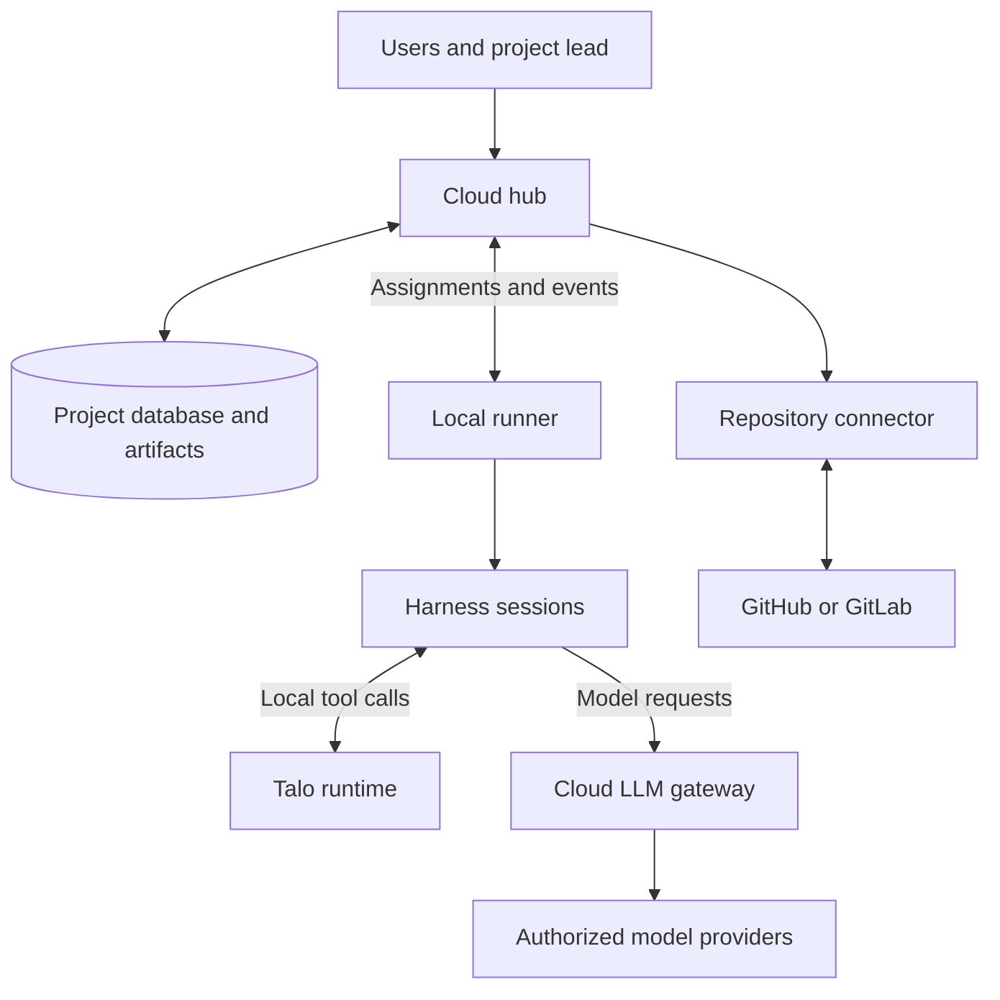
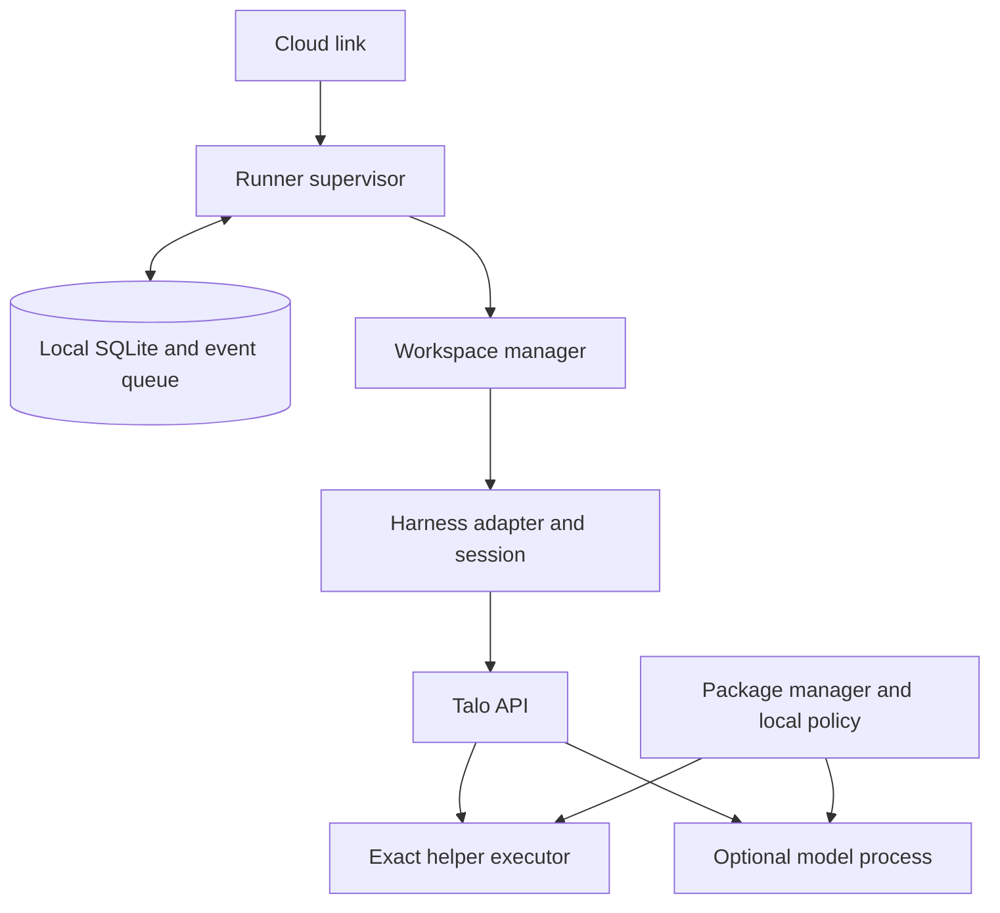
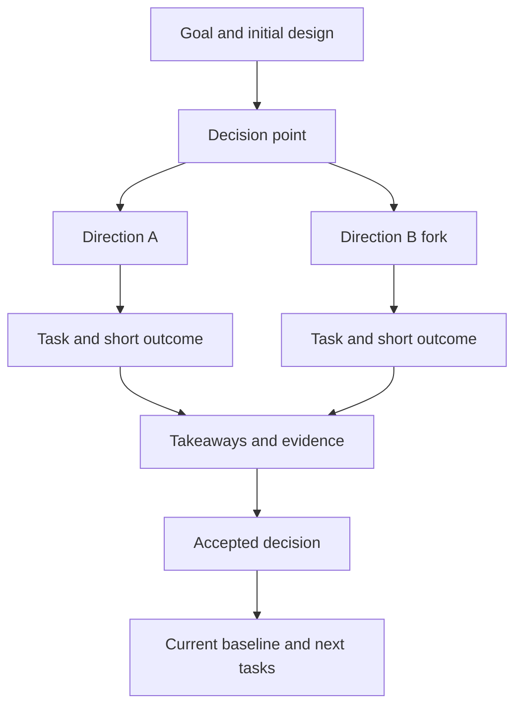
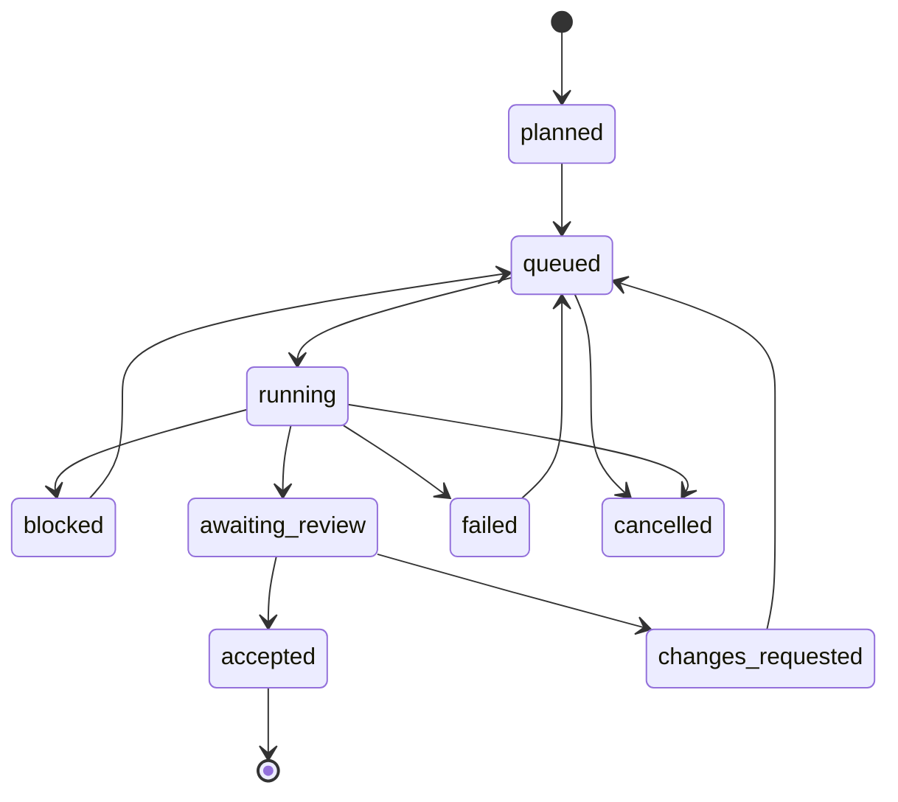
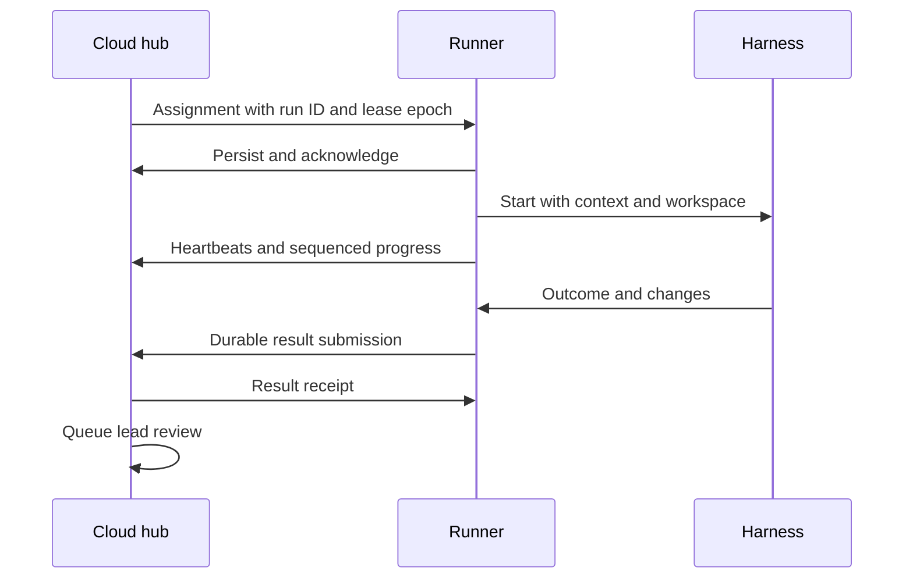
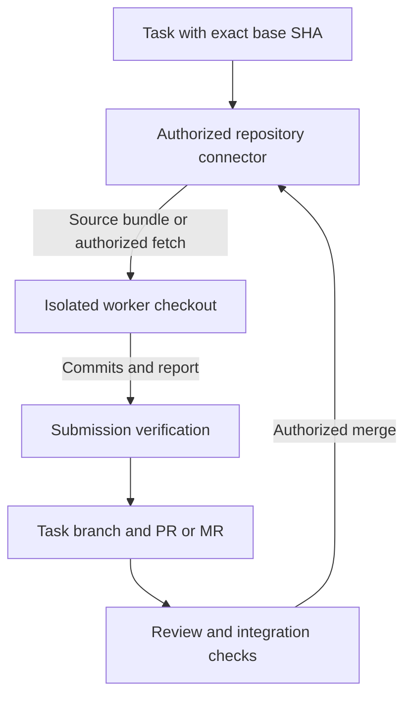
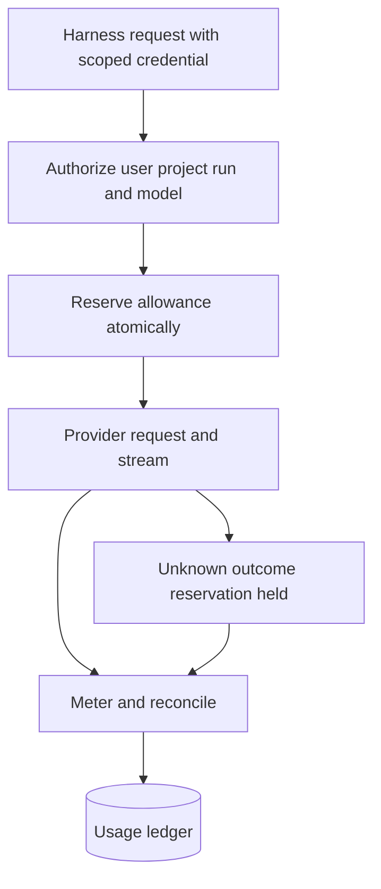
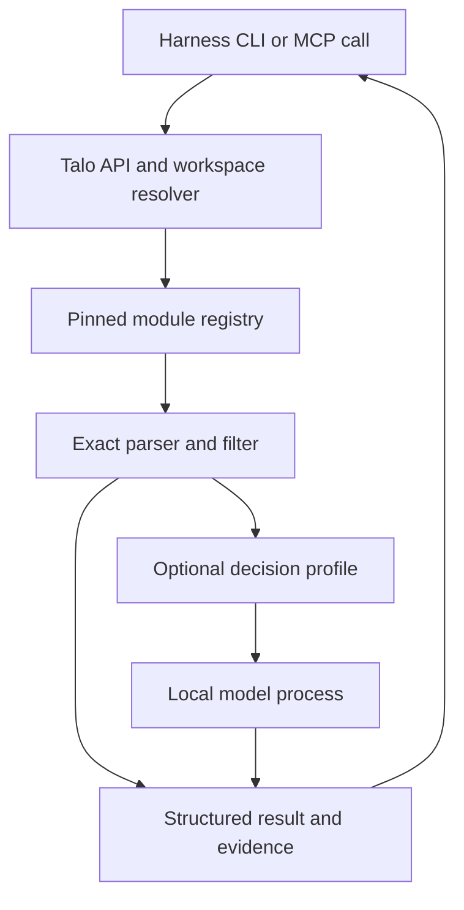
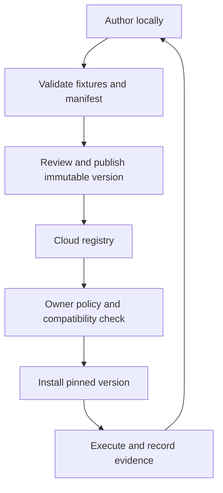

# Agent Hub Architecture

**Version 1.0 · 15 November 2026**

Architecture specification for the cloud hub, local runner and Talo runtime. All interfaces are proposed unless explicitly identified as existing.

## Contents

1. Agent Hub Architecture
2. System boundaries
3. Cloud service blocks
4. Local client blocks
5. Identities and deployment
6. Project development graph
7. Knowledge and current state
8. Task and run lifecycle
9. Delivery and offline recovery
10. Leadership and authority
11. Repository exchange
12. Model gateway and budgets
13. Talo execution and local decisions
14. Shared capabilities and skills
15. Logical data model
16. Interface contracts
17. Security and operating controls
18. Implementation phases
19. Acceptance and open decisions
20. References and design provenance

## 1 Agent Hub Architecture

Distributed harness coordination with shared project memory and Talo execution

Version 1.0 | 15 November 2026 | Architecture and implementation specification

The hub coordinates independent coding harnesses across machines. Each project assigns its own lead. The system preserves the full development path, delegates work, exchanges repository changes, and optionally supplies authorized model access through a budgeted gateway. A local client combines a runner with an independently usable Talo runtime.

### Design baseline

- A lead is a project role, not a fixed provider, account or machine. Leadership can move with a recorded handoff.
- The cloud is authoritative for shared projects; each runner is authoritative for its local processes. Standalone mode uses local storage and the same domain contracts.
- Task delegation and model access are separate paths. Compatible harnesses call the cloud LLM gateway directly.
- Project history is an append-oriented graph of proposals, decisions, tasks, outcomes, takeaways and forks. Current state is a projection of that history.
- Repository publication is controlled by an authorized connector. Contributors can return commits without receiving repository credentials.
- Talo supplies reusable exact processing and bounded local decisions. Shared packages are versioned, validated and installed under local policy.

### How to read this document

| Pages | Contents |
| --- | --- |
| 2–5 | System boundaries, cloud blocks, local blocks, identities and deployment |
| 6–10 | Development graph, context, task lifecycle, delivery and leadership |
| 11–14 | Repository exchange, model budgets, Talo and shared packages |
| 15–17 | Logical data model, interface contracts and operating controls |
| 18–20 | Implementation phases, acceptance scenarios and source references |

All interfaces, identifiers, timings and schemas below are proposed contracts. They are not claims that software has already been implemented. Provider support must be validated per integration; a callable CLI is not evidence of supported subscription delegation.


## 2 System boundaries

Two traffic paths share project identity and audit history



Figure 1. The hub schedules work; a compatible harness sends inference directly to the gateway.

| Boundary | Responsibility |
| --- | --- |
| Control path | Assignments, messages, leases, cancellation, result submission and lead activation. |
| Inference path | Model requests, provider streaming, authorization and budget accounting. |
| Local tools | Workspace-bound deterministic helpers and optional decision-model inference. |
| Repository path | Exact source revisions, returned changes and controlled publication. |

Native-provider workers may use their own supported provider connection instead of the gateway. Their usage is externally reported and may only support soft budget controls. The cloud can host a runner too; the same execution contract applies.

The lead appears as both a decision-making actor and a managed harness session. The hub schedules lead follow-ups when questions or results arrive; keeping the hub online alone does not provide an available lead.


## 3 Cloud service blocks

Shared state, scheduling and inference are explicit modules

| Block | Owns | Primary responsibility |
| --- | --- | --- |
| C1 Identity and access | Users, organizations, memberships, grants | Authenticate calls and enforce project, role and resource permissions. |
| C2 Project knowledge | Documents and immutable revisions | Manage requirements and evidence; select context without flattening provenance. |
| C3 Development history | Nodes, relations, decision events | Preserve proposals, forks, outcomes and superseded paths; derive current views. |
| C4 Task and thread service | Tasks, dependencies, messages | Track assignments, questions, responses, review state and acceptance. |
| C5 Worker scheduler | Worker capabilities, reservations, leases | Select eligible capacity, issue fenced executions and activate leads. |
| C6 Delivery and run service | Outbox, deliveries, runs, heartbeats | Deliver durable commands and reconcile retries, disconnections and late events. |
| C7 Repository coordinator | Bindings, base refs, submissions | Invoke authorized connectors; track PR/MR and integration outcomes. |
| C8 Model gateway and ledger | Provider bindings, grants, reservations | Authorize inference, reserve budget and reconcile metered usage. |
| C9 Capability registry | Package metadata and immutable releases | Publish, discover and distribute approved helpers, skills and profiles. |
| C10 Artifacts and operations | Artifact metadata, audit, notifications | Store evidence, enforce retention and expose health and cost dashboards. |

### Service shape

Start as a modular Python application with PostgreSQL, object storage and a background dispatch worker. Modules share transaction boundaries where needed; they need not become separate microservices. Separate model-streaming and job-dispatch processes when load or failure isolation justifies it.

Use a transactional outbox for state changes that require delivery. A task assignment and its outbound command must be committed together. The hub never relies on a live socket as the only record of pending work.


## 4 Local client blocks

One installation supervises runner, Talo and execution workers



Figure 2. Talo failures must not interrupt runner heartbeats or durable execution records.

| Block | Responsibility |
| --- | --- |
| L1 Cloud link | Outbound authenticated connection, enrollment, heartbeat, reconnect and event delivery. |
| L2 Runner supervisor | Job acceptance, leases, execution slots, cancellation and process recovery. |
| L3 Workspace manager | Exact checkout, isolation, dependencies, checkpoints, artifacts and cleanup. |
| L4 Harness adapters | Capability discovery; start, resume, follow up, stream and stop supported sessions. |
| L5 Talo runtime | Local tool API, exact pipelines, optional model lifecycle and evidence references. |
| L6 Package manager | Pinned installs, dependency checks, permissions, updates and rollback. |
| L7 Local policy | Owner limits, filesystem/network boundaries, runtime limits and secret grants. |
| L8 Local state | Process inventory, cached assignments, delivery offsets and buffered events. |

Prefer one runner per OS user. A machine-wide installation must isolate users and credentials explicitly. Talo can run independently; an optional local model proxy is not on the default inference path.


## 5 Identities and deployment

Roles, processes and credentials are separate concepts

| Identity | Meaning |
| --- | --- |
| Project | Shared goals, knowledge, development history, repositories and access policy. |
| Runner | A registered client installation with a device identity and local owner. |
| Worker | A harness capability offered by a runner; it may serve several authorized projects. |
| Role assignment | A project-scoped responsibility such as lead, reviewer or implementer. |
| Task and thread | A durable unit of work and its conversation, independent of a process. |
| Run | One execution attempt with worker, workspace, lease epoch and input revisions. |
| Harness session | A provider-specific conversation identifier associated with one or more turns. |
| Usage grant | Permission to consume model or worker capacity within a defined scope. |
| Repository connector | An authorized identity that retrieves or publishes repository content. |

### Standalone and connected modes

Standalone mode runs coordination locally, using SQLite and local artifact storage. Cloud mode uses PostgreSQL and object storage for shared authority; runner SQLite holds caches and pending events. Keep storage adapters behind the same domain API.

Moving a standalone project to cloud mode is an explicit migration with stable IDs and an ownership cutover. V1 does not perform unrestricted multi-master database synchronization. Disconnected runners can finish already-authorized work under policy, but cannot invent cloud assignments or spend unavailable gateway budgets.

### Capacity and data access

A collaborator grants worker capacity separately from project data access. Define allowed projects, hours, concurrency, runtime and usage limits. A capacity allocation is not a guarantee that a machine is online or a model provider has quota.

Worker selection checks capability, authorization, workspace requirements and availability. An instruction to inspect one directory is not a confidentiality boundary if the entire repository is supplied; data exposure follows the actual workspace and artifact scope.


## 6 Project development graph

Preserve how the project reached its current state



Figure 3. The interface can show a tree, while the stored graph supports forks, shared evidence and convergence.

| Node type | Required meaning |
| --- | --- |
| Proposal / decision point | Question, options, assumptions, constraints and triggering evidence. |
| Decision | Chosen option, rationale, tradeoffs, decision-maker and reconsideration conditions. |
| Task / outcome | Requested work; result, evidence, takeaways, impact, open questions and suggested next step. |
| Direction / fork | Parent direction, reason, base document revisions and relevant repository commits. |
| Integration / abandonment | What was adopted, revised or stopped, with explicit reasons and references. |

Store typed relations: caused_by, implements, depends_on, supported_by, derived_from, revises, supersedes and integrated_into. Dependency and ancestry relations must remain acyclic; general references need not form a tree.

Retain abandoned experiments and superseded decisions. Record happened_at, received_at, actor, source run and causal references so offline event arrival does not rewrite the development sequence. A project direction is not automatically a Git branch.


## 7 Knowledge and current state

Summaries remain connected to full evidence

### Revision and outcome contract

Documents have stable identities and immutable revisions. A fork references its base revisions and adds its own changes. Accepted revisions never silently change when another direction evolves. Integrating a fork produces explicit document and decision changes, including resolved conflicts.

| Outcome field | Purpose |
| --- | --- |
| Result | What was delivered or learned; separate observation from interpretation. |
| Evidence | Commit refs, test artifacts, measurements, source documents and detailed responses. |
| Takeaways | What changed in the project understanding; uncertainty and limitations. |
| Impact | Affected assumptions, requirements, directions and decisions. |
| Open questions | Unresolved issues and blockers. |
| Suggested next step | A proposal; it does not become an approved assignment automatically. |

Workers submit outcomes. An authorized reviewer accepts or revises them, preserving earlier submissions. Store full messages and artifacts behind short outcomes. The history captures observable decisions and evidence, not hidden model reasoning.

### Context assembly

The proposed context_get operation selects project instructions, accepted decisions, relevant document revisions, task scope and recent messages. It returns references and a context manifest. Runs record this manifest plus repository base and package versions. A changed requirement flags affected work for review rather than rewriting its original inputs.

### Where we are now

- Show the accepted baseline, active forks, current code references and approved architecture.
- Show completed tasks, accepted outcomes, work in progress, blockers and pending decisions.
- Show next milestones and unresolved assumptions. Multiple active paths may exist.
- Link every current item back to the history that established it. Mind-map layout coordinates are presentation data, separate from semantic graph relations.

Metadata and decision history follow project retention policy. Large logs may expire; preserve durable summaries, artifact hashes and an explicit expired-evidence marker. Deletion and redaction remain possible under ownership and privacy policy without pretending the evidence still exists.


## 8 Task and run lifecycle

Execution completion is distinct from acceptance



Figure 4. Requeueing creates a new attempt when required; historical attempts remain immutable.

Task states describe workflow. Run states describe an execution attempt: leased, preparing, running, waiting_input, submitted, failed, cancel_requested, cancelled or unreachable. A process exit does not imply task acceptance; missing heartbeats do not prove process termination.

| Transition | Required condition |
| --- | --- |
| Assign | Dependencies satisfied; worker authorized; capacity reserved; task revision recorded. |
| Start | Runner acknowledged the current lease and prepared the exact workspace. |
| Submit | Structured outcome and artifact references persisted with run ID and base revision. |
| Accept | Authorized lead/reviewer confirms acceptance criteria and required evidence. |
| Integrate | Separate project policy authorizes publication or merge; checks pass on the integration candidate. |
| Retry | Previous attempt reconciled; retry limit and budget allow another attempt. |

Review depth is configurable. Small low-risk changes may use exact checks and focused review; normal features can receive independent worker review; critical changes require deeper review. Track implementation, review and rework costs together. Passing tests is evidence, not universal proof of correctness.


## 9 Delivery and offline recovery

Durable queues and fencing prevent stale authority



Figure 5. Acknowledgement of delivery, result receipt and task acceptance are different events.

- Use at-least-once delivery with stable message IDs, idempotency keys and per-run event sequences. Deduplicate before applying state transitions.
- Illustrative defaults: heartbeat every 20 seconds, unreachable after 90 seconds; use a separately configured lease TTL. Tune these after measuring networks and suspend behavior.
- A runner reconnects with its device identity, event cursor, active run inventory and lease epochs. The hub returns authoritative continue, stop or quarantine instructions.
- After lease expiry, a new attempt receives a higher fencing epoch. Reject old management actions and integration requests; preserve late artifacts as non-authoritative evidence.
- An expired lease cannot kill a disconnected process. Require a fresh check before publication or external side effects; default to pausing at the next controllable boundary.
- Cancellation is a request followed by acknowledgement or timeout, not an immediate guarantee. Stop the process group and reconcile external effects separately.

Availability policy is selected per task: wait for the chosen worker, prefer it until a timeout, or use any eligible worker. Owner-controlled keep-awake is optional. Wake-on-LAN is outside V1. An always-on hub still needs an available execution worker and eligible lead for autonomous progress.


## 10 Leadership and authority

Project roles move without moving credentials

| Role | Allowed responsibility |
| --- | --- |
| Project owner / administrator | Memberships, budgets, repository grants and leadership policy. |
| Lead | Architecture, task decomposition, delegation, clarification and acceptance within granted scope. |
| Reviewer | Independent findings and validation; acceptance only when explicitly granted. |
| Implementer / researcher | Assigned changes or investigation; questions, progress and evidence. |
| Hub services | Enforce workflow and permissions; schedule work without inventing architectural decisions. |
| Machine owner | Local execution grants, availability and resource limits; may revoke contribution. |

### Lead handoff

Keep one active lead assignment per project in V1. Assignment includes worker ID, role instructions, capabilities, authority, budget and generation number. Reassignment atomically increments the generation and invalidates the old role lease.

The new lead receives a handoff manifest: accepted baseline, active directions, priorities, open questions, pending reviews, current worker runs and budget state. Provider-specific session history is optional; project records are the continuity mechanism.

A disconnected old lead may still compute, but its obsolete generation cannot issue accepted management actions. The hub may accept its findings as an ordinary submission for review. Previously authorized worker tasks continue unless the handoff explicitly changes them.

### Automatic lead activation

Questions and results enqueue a lead turn. Serialize turns for a given lead session and combine nearby events into a bounded briefing. Avoid recursive dispatch loops through turn limits, retry budgets and explicit dependency tracking. A role instruction alone does not ensure the harness will call the hub correctly; verify adapter behavior end to end.

### Authority boundaries

Record decision-maker, requesting user, executing worker and accepting actor separately. Lead authority does not imply repository merge rights, provider credential access or permission to expand local machine grants. The same worker may lead one project and implement another using separate sessions and workspaces.


## 11 Repository exchange

Workers can contribute commits without host credentials



Figure 6. Repository access stays with the connector in service-mediated mode.

| Mode | Access and use |
| --- | --- |
| Contributor credentials | A teammate uses their own authorized access and submits a task branch. |
| Automation identity | A trusted runner uses a scoped app/bot identity under repository policy. |
| Service-mediated exchange | Connector supplies code; worker returns commits or patches; connector publishes. Default proposal for external workers. |

Record repository ID, base SHA, task branch, result SHA, target branch and integration status. Validate returned object history against the assigned base and allowed target; import into a quarantine/task ref before publication. Git bundles preserve objects and refs; patches are an alternative with different history semantics. Local commits do not require Git-host authentication.

Concurrent tasks start from explicit revisions. After target changes, recompute the integration candidate, resolve conflicts and rerun relevant checks. Dependent tasks use the accepted prerequisite commit. Never synchronize live working directories by overwriting files.

Provision submodules, LFS objects and private dependencies explicitly. Keep author, committer, pushing identity and hub run attribution distinct. Repository-scoped tokens do not inherently restrict a worker to one branch; enforce that through connector checks and repository rules. See references [2–4].


## 12 Model gateway and budgets

Authorize inference independently from task delegation



Figure 7. The gateway owns budget enforcement; the runner supplies only the scoped hub credential.

A grant identifies budget owner, authorized principal, project, allowed providers/models, period, monetary cap, optional input/output token caps, concurrency and expiry. Derive identity and attribution from the credential; do not trust arbitrary request fields. Retain provider secrets in a vault.

Use money as the primary cross-model budget with native usage units recorded separately. Tokens, subscription allowances and provider credits are not interchangeable. Estimate or upper-bound the request cost before dispatch, including output limits and model pricing version. Where a reliable bound or provider control is unavailable, label the limit soft and apply a buffer; do not promise zero overshoot.

Reservations are transactional across concurrent calls. Reconcile against provider-reported usage. Keep uncertain reservations pending after a timeout; do not blindly replay requests that might have been billed. A disconnected stream can still consume provider usage. Record request, provider request and run IDs for reconciliation.

For native-harness traffic outside the gateway, collect available telemetry and stop future jobs when limits are approached. Do not count the same gateway usage again from harness reports. Support API access and explicitly authorized subscription integrations only; no generic subscription-credit pooling is assumed [5–9].


## 13 Talo execution and local decisions

Reuse exact operations and escalate uncertain judgments



Figure 8. Deterministic helpers work even when the optional model is unavailable.

| Capability | Examples and contract |
| --- | --- |
| Exact helpers | tests.diff, logs.trace, changes.map and i18n.check. Return stable IDs and source references. |
| Decision profiles | Routing, triage and independent multi-selection over explicit allowed outputs; permit abstention. |
| Composed pipelines | Parse → filter → optional classify → store. Keep intermediate records local. |
| Inspection | Retrieve bounded evidence by result reference instead of loading whole files into model context. |

Use discover, describe, run, decide and inspect interfaces. Inputs are one workspace-relative path, a small inline value or a result reference. Distinguish uncertainty, incomplete processing and display truncation. Scope result references to the workspace and enforce expiry.

Start with Python and an optional separate inference process. Share loaded checkpoints across authorized local calls, with bounded queues and resource limits. Evaluate model adapters before selecting a default. Record module, profile, checkpoint and policy versions on every run [1].

Measure total main-model tokens per successfully completed task, latency and quality on held-out cases. Determinism requires controlled inputs, dependencies and environment; do not cache side-effecting operations as if they were pure functions. Talo never substitutes probabilistic output for permission, budget or lease enforcement.


## 14 Shared capabilities and skills

Publish reusable behavior with explicit provenance and trust

| Package kind | Contents |
| --- | --- |
| Helper | Executable parser, comparison or validator with input/output schemas. |
| Pipeline | Declarative composition of approved, versioned operations. |
| Decision profile | Task definitions, labels, model requirements and evaluation fixtures. |
| Skill | Instructions for when and how a harness should use capabilities; adapter-specific installation where needed. |
| Bundle | A pinned set of compatible helpers, profiles and skills. |



Figure 9. Sharing a package does not automatically grant execution permission.

Each release declares ID, owner, visibility, version, content hash, runtime/OS/architecture requirements, dependencies, schemas, requested permissions and resource limits. Publish tests and evaluation evidence, provenance and license information. Pin dependency and model references; verify redistributed model licensing separately.

Use private, project, organization and public visibility. Promotion requires the appropriate publishing role. Keep running tasks on their original release; updates create new versions with rollback support. Revocation blocks new execution and flags impacted runs; downloaded copies cannot be assumed erased remotely.

Begin with reviewed built-ins and declarative pipelines. Execute third-party code only inside an enforced sandbox with controlled mounts, networking, time and memory. Fixtures demonstrate behavior on examples, not safety. Discovery returns a short catalog; load schemas and instructions on demand.


## 15 Logical data model

Stable identities link project history to executable evidence

| Group | Proposed records | Key links and invariants |
| --- | --- | --- |
| Identity | organizations, users, memberships, grants | Tenant and project scope enforced on every reference. |
| Projects | projects, repositories, connector_bindings | Repository authority independent of worker or lead identity. |
| Knowledge | documents, document_revisions, context_manifests | Immutable revisions; manifests pin exact inputs. |
| History | history_nodes, history_edges, decisions, directions | Fork baseline and causal edges preserved; typed graph validation. |
| Work | tasks, task_dependencies, outcomes | Task owns intent; outcome references run and evidence. |
| Threads | threads, messages, attachments | Reply links, sender identity and durable delivery IDs. |
| Workers | runners, workers, worker_capabilities | Availability and capability revisions are distinct from authorization. |
| Leadership | project_role_assignments, role_leases | One current lead per project; monotonically increasing generation. |
| Execution | runs, job_leases, run_events, deliveries | Attempt IDs, fencing epochs, per-run sequence and idempotency. |
| Git | workspaces, submissions, integration_attempts | Base/result SHA, task ref, target and acceptance provenance. |
| Budget | provider_bindings, usage_grants, reservations, usage_entries | Atomic allocation; unique charge identity; pending unknown usage. |
| Capabilities | packages, releases, installs, capability_runs | Immutable hashes; installed version and invocation evidence. |
| Operations | artifacts, audit_events, outbox_events | Object refs and integrity metadata; durable delivery and retention. |

### Storage policy

This is a logical model, not final DDL; related records may share tables in V1. PostgreSQL is the proposed shared store. Use SQLite on local filesystems for standalone mode and runner state, with WAL, short write transactions and a busy timeout [10].

Store large logs, screenshots, code bundles and checkpoints in artifact storage; store references and hashes in the database. Credentials are vault/keychain references, not document or message fields. Use database transactions for assignment/outbox creation, lead handoff, budget reservation and result deduplication.


## 16 Interface contracts

One domain API with HTTP CLI and MCP adapters

| Surface | Proposed actions |
| --- | --- |
| Project and context | project_create, project_get, context_get, document_publish_revision |
| Development history | proposal_create, decision_record, direction_fork, outcome_submit, history_query |
| Roles and workers | worker_register, worker_capabilities_update, lead_assign, lead_handoff |
| Tasks and threads | task_create, task_assign, task_get, thread_read, message_send, task_accept |
| Runner control | assignment_receive, assignment_ack, lease_renew, run_event_append, result_submit, run_cancel |
| Repositories | workspace_prepare, submission_upload, submission_verify, change_publish, integration_request |
| Gateway and budgets | grant_create, grant_revoke, usage_get; provider-compatible inference endpoints |
| Talo | discover, describe, run, decide, inspect |
| Packages | package_publish, package_search, package_install, package_revoke, package_rollback |

### Assignment envelope

```text
schema_version, command_id, project_id, task_id, run_id
worker_id, lease_epoch, lease_expires_at, role_generation
context_manifest_ref, repository_id, base_commit_sha
package_lock_ref, execution_policy_ref, deadline
```

Server-issued credentials are delivered separately through a secure channel. A runner persists the envelope before acknowledgement. Unknown schema versions fail explicitly; capability negotiation prevents assigning unsupported resume, cancellation or streaming operations.

### Result envelope

```text
schema_version, event_id, run_id, lease_epoch, sequence
outcome_status, summary, takeaway_refs, question_refs
submission_ref, evidence_refs, usage_refs
happened_at, received_at
```

Authenticate the sender independently from payload identity. Apply optimistic revision checks to mutable records. Tools return typed errors such as stale_lease, permission_denied, budget_exhausted, capability_unavailable and conflict. Duplicate delivery returns the original receipt.

MCP provides tool access to an active harness; it is not the worker wake-up mechanism. CLI and MCP adapters call the service API rather than opening a competing dispatcher or bypassing domain checks. Names here are proposed, not existing product commands.


## 17 Security and operating controls

Enforce boundaries where actions actually occur

| Concern | Required control |
| --- | --- |
| Cross-project access | Tenant/project authorization on API reads, artifacts, searches, graph edges and result refs. |
| Local execution | OS-enforced isolation for external jobs; worktrees alone are not a security sandbox. |
| Secrets | Short-lived scoped hub credentials; separate provider and Git credentials; no secrets in prompts or logs. |
| External side effects | Lease and authorization checks at connectors; idempotency where the destination supports it. |
| Untrusted content | Treat repository text, package instructions and worker outputs as data; they cannot expand grants. |
| Publication | Validate branch/ref policy; keep integration credentials out of worker build/test environments. |
| Inference | Enforce model and spend policy in the gateway, with streaming deadlines and pending-usage reconciliation. |
| Offline execution | Default pause at a controllable boundary when authority expires; owner stop controls remain local. |
| Package execution | Pinned hashes, provenance, explicit permissions and sandbox resource limits. |
| Data lifecycle | Project retention, deletion/redaction workflow, backups and restore validation. |

### Operational signals

Track queue age, runnable worker capacity, expired leases, repeated delivery failures, lead wait time, run duration, review latency, integration conflicts, pending budget reservations and gateway usage. Distinguish provider limits from runner failures. Alert on sustained stalls rather than every heartbeat miss.

### Recovery and audit

Back up metadata and referenced artifacts consistently; test restore against a known project history and pending job set. After restart, reconcile outstanding leases and reservations before issuing replacements. Logs use correlation IDs and omit credentials and unnecessary source content.

The local owner can pause new work, cancel a run or disconnect the runner. Cloud access revocation prevents new access but cannot erase source code already downloaded to another machine. Project owners approve the actual data exposure when enrolling external contributors.


## 18 Implementation phases

Deliver useful execution before broad automation

| Phase | Scope | Exit evidence |
| --- | --- | --- |
| 1 Local foundation | Python domain core, SQLite, task/thread/history records, one runner, one verified harness adapter and Talo tests.diff. | A task produces code, exact test evidence and an accepted outcome; service restart preserves pending work. |
| 2 Cloud coordination | PostgreSQL, authentication, outbound runners, durable delivery, leases and project-scoped lead assignment. | Two machines collaborate; sleeping runner and lead handoff cases pass without duplicate authoritative actions. |
| 3 Repository exchange | Exact revision contracts, connector, bundles/patches, task refs and integration checks. | A worker without Git-host credentials returns changes that become a reviewed PR/MR. |
| 4 Managed inference | Gateway, provider bindings, scoped grants, transactional reservations and usage reports. | Concurrent calls cannot spend the same reservation; unknown provider outcomes stay pending. |
| 5 Capability sharing | Registry, pinned packages, skills, install policy and isolated code execution. | A reviewed helper is reused on another compatible machine with the same fixture results. |
| 6 Evaluated decisions | Local decision profiles, evaluation harness, uncertainty escalation and quality reports. | Profiles meet agreed quality tolerance and improve total tokens or latency per accepted task. |

### Suggested implementation choices

Use Python first for service orchestration and helper development. Keep adapter and domain contracts language-neutral so a Rust runner or executor can be introduced later for packaging or isolation needs. Avoid a second orchestrator stack until the durable job model is proven.

Use a modular application, relational storage and an outbox-backed job worker initially. A separate broker is an optimization, not the source of truth. Choose outbound WebSocket or long polling for runner control; provide reconnect cursors regardless of transport.

Begin with the existing Talo exact-processing milestone and one end-to-end task. Add provider adapters only after capability and authentication checks. Consumer subscription support must not be inferred from a third-party orchestration repository.


## 19 Acceptance and open decisions

Validate the failure paths before unattended use

| Scenario | Expected result |
| --- | --- |
| Duplicate assignment | One authoritative execution; duplicate command receives the same acknowledgement. |
| Runner sleeps mid-task | Run becomes unreachable; replacement is fenced; late results are retained without automatic acceptance. |
| Lead changes | New generation can manage tasks; old lead actions are rejected; existing work is reconciled. |
| Fork exploration | Base revisions remain stable; outcomes and rejected alternatives remain discoverable. |
| Requirement changes | Affected run is flagged against its pinned context; original evidence remains intact. |
| Two concurrent code changes | Exact bases are recorded; integration candidate is checked after target movement. |
| Gateway concurrency | Atomic reservations prevent double allocation; usage reconciles once. |
| Provider timeout | Possible billing remains pending; the service does not blindly retry as a free request. |
| Unknown package or model | Execution fails clearly or uses an authorized fallback; no silent version/model substitution. |
| Local model unavailable | Deterministic Talo helpers still work; semantic requests return a typed unavailable outcome. |
| Cross-project artifact request | Access is denied even when the caller knows an object identifier. |
| Restore from backup | History, pending delivery and artifact references are consistent; leases are reconciled. |

### Decisions still required before implementation

- Choose the first supported OS and harness version, then verify launch/resume/cancel behavior.
- Choose the initial Git host and whether its connector lives locally or in the cloud.
- Define default publication authority, task review depth and external-worker data scope.
- Select the isolation mechanism and package publishing policy for executable extensions.
- Set budget periods, treatment of unknown usage, retention windows and backup objectives.
- Choose a local decision-model candidate through evaluation; no checkpoint is an accepted default yet.


## 20 References and design provenance

Architecture baseline and external integration boundaries

The architecture consolidates the project decisions made in this conversation and the existing Talo design. External references describe integration primitives and constraints; they do not certify this proposed platform. Provider policies and interfaces must be rechecked before each adapter release.

**[1] [Talo Service Design](https://chatgpt.com/library?file_id=libfile_eb47d059ba008191944f733addb192bd&account_id=personal).** Existing project design: local exact modules, decision profiles, CLI/MCP contracts and quality evaluation.

**[2] [Git bundle documentation](https://git-scm.com/docs/git-bundle).** Repository objects and refs can be transferred through bundles.

**[3] [GitHub App installation tokens](https://docs.github.com/en/apps/creating-github-apps/authenticating-with-a-github-app/generating-an-installation-access-token-for-a-github-app).** Repository and permission scoping; short-lived installation access.

**[4] [GitLab project access tokens](https://docs.gitlab.com/user/project/settings/project_access_tokens/).** Project bot identity, access scopes and availability.

**[5] [OpenCode providers](https://opencode.ai/docs/providers/).** Supported provider connections and account-specific model discovery.

**[6] [Claude Code legal and compliance](https://code.claude.com/docs/en/legal-and-compliance).** Native authentication and third-party use restrictions; do not assume subscription redistribution.

**[7] [Google Antigravity FAQ](https://antigravity.google/docs/faq).** Consumer-plan restrictions on third-party access and CLI wrapping.

**[8] [Sign in with ChatGPT](https://learn.chatgpt.com/docs/sign-in-with-chatgpt).** Supported integrations and plan-use permissions; not blanket cloud proxy authorization.

**[9] [GitHub Copilot and OpenCode](https://github.blog/changelog/2026-01-16-github-copilot-now-supports-opencode/).** Official OpenCode integration; does not establish resale rights for a custom hub.

**[10] [SQLite WAL](https://sqlite.org/wal.html).** Concurrent readers and serialized writes; local-host filesystem constraints.

**[11] [Model Context Protocol transports](https://modelcontextprotocol.io/specification/2025-11-25/basic/transports).** Tool connections over stdio or Streamable HTTP; runner activation is a separate concern.

Reference basis: documentation consulted on 15 November 2026. The project remains provider-neutral: unsupported adapters stay disabled, while API-backed or explicitly approved integrations can use the same worker and budget contracts.
