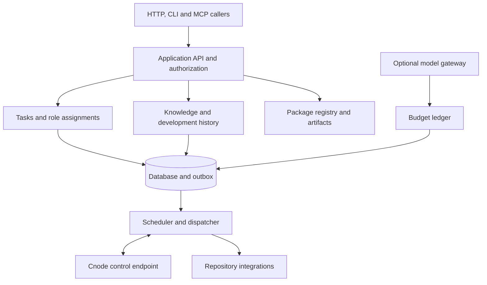

# Anode architecture

Design 0.1. Normative boundaries below are targets for implementation, not shipped functionality.

## Runtime structure

Start as a modular Python application with three process roles: API, background dispatcher/reconciler and optional model gateway. Modules share a database and transaction manager. They are not ten independently deployed microservices. Use a transactional outbox before introducing a separate message broker.

| ID / module | Owns | Required behavior | Does not own |
| --- | --- | --- | --- |
| A1 Identity and access | Principals, organizations, memberships, grants | Authenticate independently of request body; authorize every referenced resource and operation. | Harness login sessions. |
| A2 Knowledge | Documents, revisions, context manifests | Immutable content revisions and bounded context assembly. | Local filesystem access. |
| A3 Development history | Decisions, directions, graph relations, projections | Preserve causal history, rejected alternatives and fork baselines. | Hidden model reasoning. |
| A4 Work and conversation | Tasks, dependencies, messages, outcomes | Stable task threads; explicit review and acceptance. | Process lifetime. |
| A5 Scheduler and leadership | Worker capabilities, capacity, lead generations | Select eligible workers, reserve capacity, serialize lead turns. | Overriding machine-owner policy. |
| A6 Delivery and runs | Leases, commands, event receipts, reconciliation | At-least-once delivery, deduplication and stale-authority rejection. | Killing an unreachable OS process. |
| A7 Repository coordinator | Repository bindings, submissions, integration attempts | Exact base/result revisions and authorized publication. | Trusting worker tests as final acceptance. |
| A8 Gateway and budget | Scoped inference grants, reservations, ledger | Concurrent reservations and uncertain-usage reconciliation. | Unapproved subscription pooling. |
| A9 Capability registry | Package identities and immutable releases | Search, publish, pin, revoke and distribute packages. | Granting local execution permission. |
| A10 Artifacts and operations | Object metadata, audit, retention, metrics | Authorized upload/download and observable recovery. | Indefinite retention of all raw logs. |

## Authority and data paths

The server owns shared project state. Cnode owns its local processes and may reject an otherwise valid assignment. A lead has delegated project authority, bounded by role permissions. Repository publication uses a separate connector identity. The gateway checks inference grants independently of task delegation.

For each assignment, record the task revision, immutable context manifest, repository base, package lock and policy revision. Changes to any of them create a new revision; an in-flight run retains the inputs it used.

Control traffic is durable and relatively small. Repository bundles, logs and reports travel through authorized artifact transfers. Model streams go directly from a compatible harness to the optional gateway. Cnode is not a mandatory model proxy.

## First execution flow

1. A user or authorized lead creates a task with acceptance criteria and dependency references.
2. The scheduler checks dependencies, permission, current capacity and required capabilities.
3. A transaction creates a run, lease and assignment command, reserving its execution slot.
4. Cnode persists the assignment before acknowledging it, then prepares the workspace.
5. Cnode uploads evidence and submits an outcome using the same run ID and lease epoch.
6. Anode persists the result receipt and queues review in one transaction.
7. An authorized reviewer accepts or requests changes. Publication is a separate authorized operation.

Execution completion, outcome acceptance and repository integration are separate state transitions.

## Dynamic lead

One active lead per project in the first release. A lead assignment has a monotonically increasing `generation`. Reassignment increments it transactionally and invalidates old management authority. Worker execution leases are separate: changing the lead does not silently cancel existing workers.

A handoff manifest includes accepted decisions, active directions, current tasks, outstanding questions, pending reviews and budget state. Provider conversation continuity is optional. Questions and results enqueue a bounded lead turn; only one turn may mutate a given lead session at a time. Apply turn, retry and budget limits to prevent endless delegation loops.

## Modes

| Mode | Anode storage | Cnode connection | Authority |
| --- | --- | --- | --- |
| Standalone | Local SQLite and filesystem artifacts | Loopback server | Local Anode owns the project. |
| Shared cloud | PostgreSQL and object storage | Outbound authenticated HTTPS | Shared Anode owns the project. |
| Cloud-hosted worker | Same cloud server | A Cnode hosted on a VM or execution host | Same contract as a desktop Cnode. |

Moving a standalone project is an explicit export/import with stable IDs and a write cutover. The first release has no unrestricted multi-master project synchronization.
