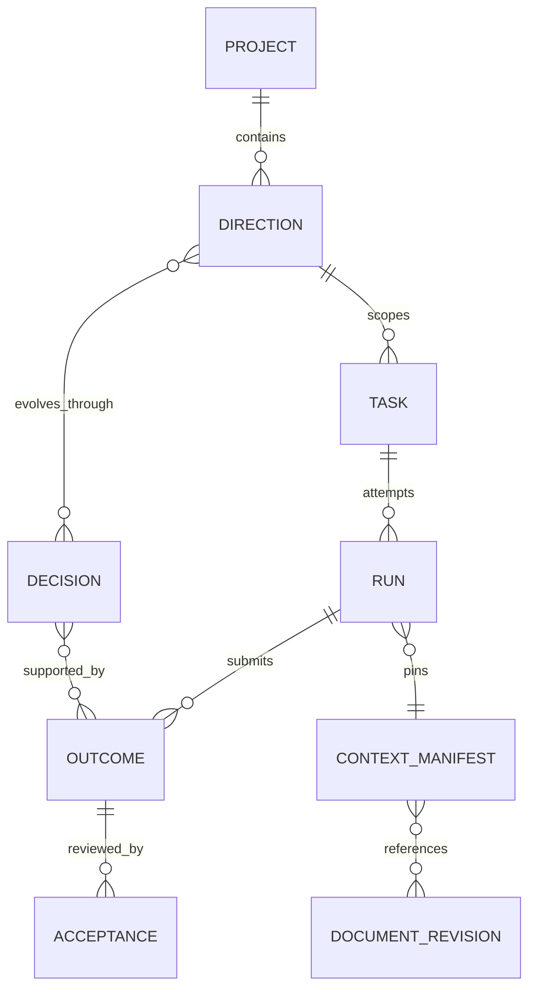

# Logical data model

This is a schema design, not executable DDL. Exact columns and indexes are implementation work. Use database constraints for invariants wherever feasible; do not rely solely on prompts or API handlers.

| Group | Records | Key constraints and links |
| --- | --- | --- |
| Access | organizations, users, memberships, grants | Principal identity is distinct from device and worker. Explicit tenant/project scope. |
| Projects | projects, repositories, connector_bindings | Stable project ID; connector secrets are vault references. |
| Knowledge | documents, document_revisions, context_manifests | Unique document/version; immutable content hash and referenced revisions. |
| History | history_nodes, history_edges, decisions, directions | Typed endpoints; parent and base refs; accepted decisions retain actor and evidence. |
| Work | tasks, task_dependencies, outcome_revisions, acceptances | Optimistic task revision; dependency graph acyclic; acceptance pins outcome. |
| Conversations | threads, messages, attachments | Sender, reply-to, task association, artifact refs and client idempotency key. |
| Workers | runners, workers, capability_revisions, capacity_grants | Worker belongs to runner; availability and authorization are separate. |
| Leadership | role_assignments, role_leases | One active lead per project; generation increases on transfer. |
| Execution | runs, run_leases, run_events, command_receipts | Unique run ID; lease epoch, attempt lineage and durable event sequence. |
| Delivery | outbox_events, runner_commands, delivery_receipts | Durable per-runner ordering; replay until acknowledged. |
| Repository | submissions, integration_attempts | Repository/base/result refs; candidate target; independent publication authority. |
| Inference | provider_bindings, usage_grants, reservations, usage_entries | Atomic allowance; unique request charge; uncertain usage held. |
| Packages | packages, package_releases, release_revocations | Immutable version/hash; visibility and publisher role. |
| Artifacts | artifacts, artifact_grants | Hash, bytes, content type, owner, project, retention and transfer state. |
| Operations | audit_events, migration_jobs | Correlation IDs, actor and action; explicit export/cutover state. |

## Transaction boundaries

1. **Assignment:** verify eligibility, reserve capacity, create run/lease, and append assignment/outbox in one transaction. Lock the affected capacity or use equivalent conditional updates.
2. **Result:** authenticate runner/run/epoch, deduplicate event, persist outcome/artifact references, update review state, and append lead notification atomically.
3. **Leadership:** increment generation, supersede old role assignment, issue handoff event and invalidate old management authority atomically.
4. **Budget:** reserve remaining allowance atomically across concurrent requests; settle once per request identity. Unknown usage remains reserved.
5. **Acceptance:** verify optimistic revisions and authority; pin accepted outcome and create history events atomically.

Artifact bytes upload before a result references them. Finalization checks size/hash and ownership. Unreferenced uploads are garbage-collected after a grace period. A database commit cannot atomically commit an object store upload; model the intermediate states explicitly.

## State and identifiers

IDs are opaque strings at the protocol boundary; choose their generation algorithm in implementation. Never authorize solely from an ID prefix. Server UTC timestamps use RFC 3339. Distinguish happened time, received time and authoritative ordering.

Task state: `planned`, `queued`, `running`, `blocked`, `awaiting_review`, `changes_requested`, `accepted`, `failed`, `cancelled`.

Run execution state: `leased`, `preparing`, `running`, `waiting_input`, `submitted`, `failed`, `cancel_requested`, `cancelled`. Reachability is an independent field (`online`, `unreachable`), so lost heartbeats do not overwrite the last execution state. The earlier architecture's “unreachable run state” is refined into this separate dimension.

Result authority: `current`, `late_quarantined`, `superseded`. A late result can be retained without reopening or accepting a replaced attempt.

## Storage boundaries

PostgreSQL is the cloud authority. Local Anode uses SQLite on a local filesystem with serialized writes and short transactions. Cnode has its own SQLite database; it never writes the server database directly. Large documents, logs and source bundles live in artifact storage with database references. Do not store secrets in task JSON, graph nodes or copied configuration.

Index by tenant/project, task state, runnable dependency status, runner pending command, lease expiry, event deduplication key, and reservation state. Enforce uniqueness on `(runner_id, command_id)`, `(run_id, event_id)` and `(run_id, sequence)`; reject a reused key with different content.
