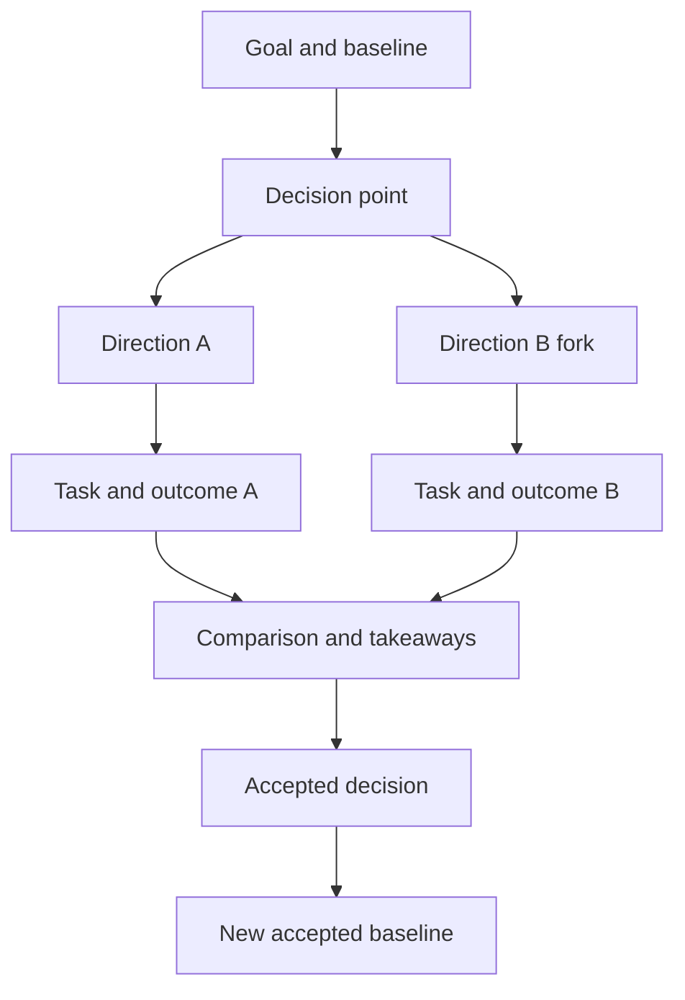

# Project knowledge, directions and history

## Goal

At any point a user must be able to answer: what are we building now, what did we try, which decision changed direction, what evidence caused it, what was rejected, and what remains unresolved?

Use a graph as the stored model. A tree or mind map is a presentation of that graph, since branches can share evidence and later converge.

## Record types

| Record | Required content |
| --- | --- |
| Goal / requirement | Intent, constraints, owner, revision and acceptance criteria. |
| Proposal / decision point | Question, candidate options, assumptions and triggering evidence. |
| Decision | Chosen option, alternatives, rationale summary, tradeoffs, actor and conditions for reconsideration. |
| Direction | Parent direction, objective, current status and originating decision. |
| Fork | Immutable base document revisions, code refs, assumptions and reason for exploration. |
| Task | Scope, acceptance criteria, dependencies, direction and input revision. |
| Outcome | Short result, evidence, takeaways, impact, open questions and suggested next step. |
| Integration / abandonment | What was adopted or stopped, why, and which revisions or outcomes were affected. |

All history records include `project_id`, author/actor, `happened_at`, server `received_at`, source run if present, and causal references. Client clocks do not define causal order.

## Relations

`caused_by`, `implements`, `depends_on`, `supported_by`, `derived_from`, `revises`, `supersedes` and `integrated_into` are distinct relation types. Validate endpoint kinds and tenant/project scope. Enforce acyclicity for dependency and ancestry relations; general evidence links need not be acyclic.

Documents have stable IDs and immutable revisions. A fork pins revisions rather than referring only to “latest.” Accepting a fork creates explicit adopted revisions and integration events, preserving conflicting or abandoned alternatives. A direction is not automatically a Git branch.

## Task outcomes

Keep the full response and attachments behind a short structured outcome. An outcome submission remains immutable; a correction supersedes it. Acceptance records the reviewer, exact outcome revision and decision. A successful process exit or passing test does not create acceptance automatically.

| Outcome section | Meaning |
| --- | --- |
| Result | What was delivered or learned; distinguish observations from interpretations. |
| Evidence | Exact code refs, reports, measurements and source references. |
| Takeaways | Changed understanding, uncertainty and limitations. |
| Impact | Requirements, assumptions and decisions affected. |
| Open questions | Blockers and unresolved decisions. |
| Suggested next step | Proposed work; scheduling still requires authority. |

## Context assembly

`context_get` selects instructions, relevant document revisions, accepted decisions, task scope, recent messages, package references and repository bases. It produces an immutable manifest with explicit references and omissions. Context selection must apply access control before retrieval, including search results and artifact excerpts.

Do not place the entire project history in every prompt. Return a concise briefing plus references for deeper inspection. Store the manifest used by each run. If a requirement changes, flag affected runs and decisions for review rather than rewriting their evidence.

## Current project view

Build rebuildable projections of accepted baseline, active forks, task status, pending reviews, current code refs, unresolved assumptions and upcoming milestones. Each visible item links to the records that established it. Projection writes are not a second source of truth.

UI coordinates, collapsed branches and mind-map colors are separate view preferences. A UI drag must not silently rewrite a semantic dependency.

## Retention

Preserve decision summaries, accepted outcomes and causal references according to project policy. Raw logs may expire; retain an explicit expired-evidence marker and integrity metadata. Support authorized deletion/redaction without pretending removed evidence still exists. Capture observable work and rationale summaries, not private model chain-of-thought.

## Acceptance scenarios

- Fork from revision 4; publish revision 5 on the parent; the fork still references revision 4.
- Compare two alternatives, reject one and later find its reasons and outcomes.
- Receive an old offline event; preserve its source timestamp without changing causal ancestry.
- Rebuild current state from authoritative records and obtain the same baseline.
- Deny a cross-project evidence reference even when its identifier is known.
