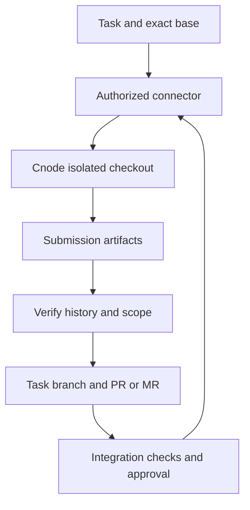
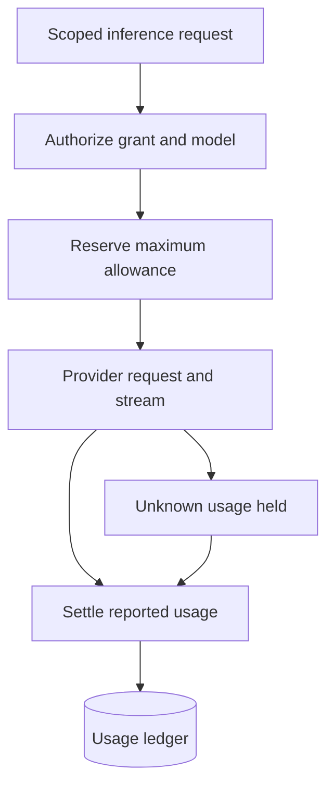

# Repository exchange and model budgets

## Repository modes

| Mode | Worker access | Publication |
| --- | --- | --- |
| Contributor credentials | Owner explicitly grants use of their own Git-host identity. | Task branch under repository policy. |
| Automation identity | Scoped bot/app identity in a trusted connector or execution environment. | Connector checks repository/ref permissions. |
| Mediated exchange | Exact source bundle or approved snapshot, no Git-host credentials. | Worker returns commits/patches; connector verifies and publishes. |

Mediated exchange is the default proposal for external contributors. Repository access remains with an authorized connector, independently of whichever worker currently leads the project. The connector may run server-side or on a separately authorized trusted Cnode; location does not change authority rules.

Record repository ID, base commit, result commit, source hash, task ref, target ref and integration attempt. Check bundle integrity and ancestry against the assigned base, import into a quarantine ref, and inspect scope before publication. Patch-based exchange records the resulting commit produced by the connector; it does not pretend to preserve the worker's original commit identity.

If the target moves, recompute the integration candidate and rerun relevant checks. Do not merge a candidate tested only against an old target. Dependent work starts from the accepted prerequisite revision. Track author, committer, publishing identity and run attribution separately.

A clean source checkout may still require LFS objects, submodules, private dependencies, environment configuration or generated assets. Declare these explicitly. Do not share a live working tree or copy personal credentials into it. Worker build/test execution never receives merge credentials by default.

## Model gateway path

Compatible harness → Anode gateway → authorized provider. Cnode injects only a scoped, short-lived gateway credential into the assigned process. Native harness traffic can remain on its supported provider connection; that traffic has separate accounting limitations.

The gateway is optional and can ship after task orchestration. Implement a provider adapter only after confirming API shape, streaming, cancellation, usage reports and allowed authentication. Subscription tokens are not a generic transferable currency. This design does not approve resale or third-party use of any consumer subscription.

## Grant and ledger

A usage grant pins budget owner, principal, project, optional run, allowed providers/models, period, currency, monetary cap, optional input/output token caps, concurrency and expiry. Derive attribution from the authenticated credential; never trust a user-supplied budget owner.

Before dispatch, reserve a reliable upper bound including output limits and pricing version. Record reserved amounts, actual native usage units and reconciled charge separately. If a reliable bound cannot be established, label the budget **soft** and apply a buffer. Do not advertise a strict cap based on an estimate alone.

Reservations must be atomic across concurrent calls. Settle a provider request once. Hold unknown usage after disconnect or timeout; do not immediately free it and do not blindly resend a possibly billed call. Reconciliation may resolve it later or require an explicit administrative adjustment with an audit trail.

Track one source of truth per charge. A Cnode report describing a gateway request references its request ID rather than charging it again. Native-harness telemetry is observational unless enforcement exists on that path; stop future assignments as configured, but do not promise exact token control.

## Acceptance

- Two concurrent requests cannot spend the same remaining allowance.
- A provider timeout keeps the reservation pending and does not trigger an automatic free retry.
- A stale run cannot obtain a fresh gateway credential or publish code.
- A worker without Git-host access can return reviewable changes through the connector.
- Target movement invalidates the old integration candidate.
